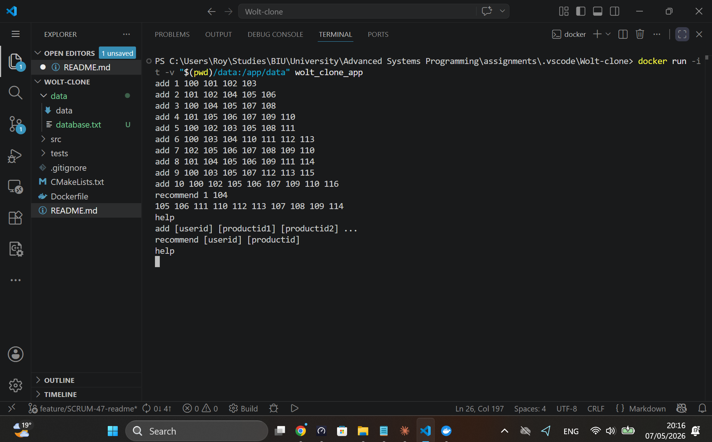
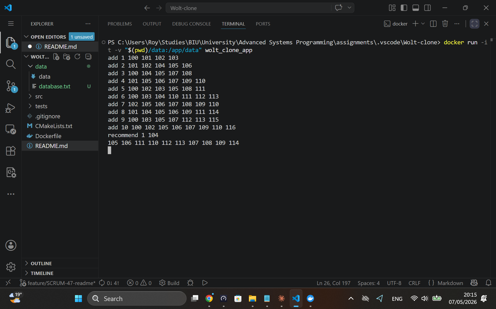
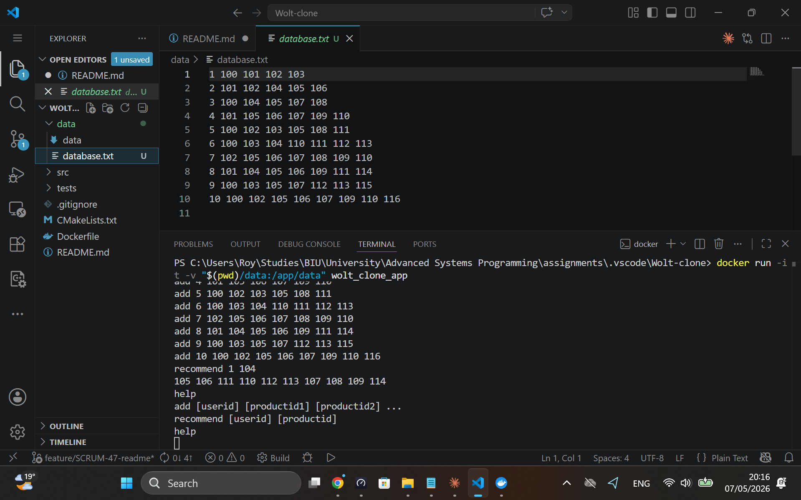
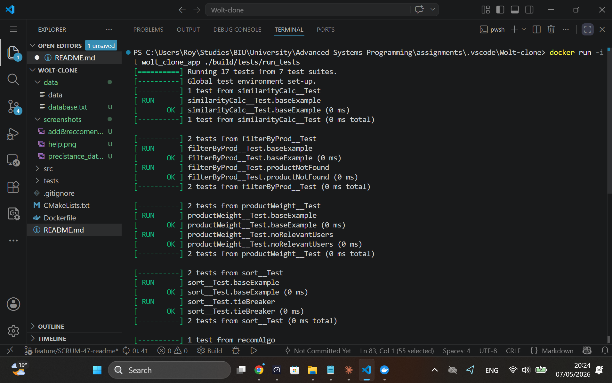
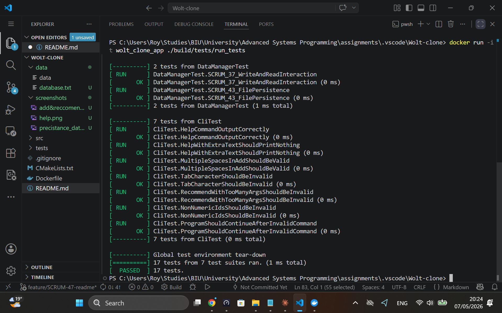

This version refines the layout for maximum readability, using clear headers, task lists, and professional code blocks. It also structures the technical sections to highlight the engineering principles you’ve applied.

---

# Wolt-Clone Recommendation System (Ex1)

[](https://isocpp.org/)
[](https://github.com/google/googletest)
[](https://www.docker.com/)

A high-performance C++ CLI application providing product recommendations based on user interaction history. This system implements a **"Similar Taste"** algorithm to simulate the core logic of delivery platforms like Wolt.

---

## 👥 Team Members

| Name |
| :--- |
| **Dana Sela** |
| **Roy Carmelli** |

---

## 🚀 Project Overview

The Wolt-Clone Recommender tracks user behavior and suggests relevant products using cross-user similarity metrics. The system is built with a focus on persistence, robustness, and clean architectural patterns.

### Key Features
*   **Interaction Tracking:** Log user views in real-time via the `add` command.
*   **Smart Recommendations:** Generates top-10 recommendations based on community-based filtering.
*   **Data Persistence:** Automatic file-based storage in the `data/` directory.
*   **Resilient CLI:** Built-in protection against malformed inputs, multiple spaces, and invalid characters.

---

## 🛠 Software Engineering Principles

### 1. SOLID & Architecture
The system prioritizes **Loose Coupling**. By utilizing interfaces like `IDataReadable` and `IDataWriteable`, we decoupled the core recommendation logic (`Recommender` class) and the UI (`Cli` class) from the persistence layer.
> **Future Proof:** This architecture allows for a seamless transition to a database (e.g., MongoDB) without modifying the business logic.

### 2. Test-Driven Development (TDD)
Developed using the **GoogleTest (GTest)** framework following the **Red-Green-Refactor** cycle:
*   🔴 **Red:** Writing failing tests for new requirements.
*   🟢 **Green:** Implementing minimal code to pass tests.
*   🔵 **Refactor:** Optimizing code while maintaining green status.

### 3. Persistence
Managed by the `DataManager`, ensuring every `add` command immediately updates the physical storage. The application restores state automatically upon startup to ensure session continuity.

---

## 📂 Project Structure

```text
├── src/           # Core implementation files (.cpp and .h)
├── data/          # Persistent storage (database.txt)
├── tests/         # Unit and Integration tests (GTest)
├── Dockerfile     # Containerization configuration
└── CMakeLists.txt # Build configuration
```

---

## 💻 How to Run

### 1. Using Docker (Recommended)
Ensures an identical execution environment across all machines.

**Build the image:**
```bash
docker build -t wolt_clone_app .
```

**Run the application (with Persistence):**
```bash
docker run -it -v "$(pwd)/data:/app/data" wolt_clone_app
```

**Run the automated tests:**
```bash
docker run -it wolt_clone_app ./build/tests/run_tests
```

### 2. Manual Build (CMake)
Requires CMake and a C++ compiler (GCC/Clang).
```bash
mkdir build && cd build
cmake ..
make
./WoltClone
```

---

## 📝 Usage & Examples

| Command | Description |
| :--- | :--- |
| `add [uid] [p1] [p2]...` | Add product interactions to a user's history. |
| `recommend [uid]` | Get the top-10 recommended products. |
| `help` | Display available commands and usage info. |

---

## 📸 Execution Screenshots

### 1. Help & CLI Robustness
*Demonstrates command listing and resilience to extra whitespaces/tabs.*


### 2. Recommendation Example
*Shows the algorithm generating deterministic recommendations (sorted by ID in case of equal weight).*



### 3. Automated GTest Suite
*Proof of all Unit and Integration tests passing.*



---

## 📊 Project Management
Managed using **Agile Scrum** via **JIRA**. 
*   **Workflow:** Feature-branch strategy.
*   **Quality Control:** Merges to `main` only occurred after successful **Peer Code Reviews** and passing CI tests.

---
*Created for the Advanced Systems Programing Course, 2026.*
