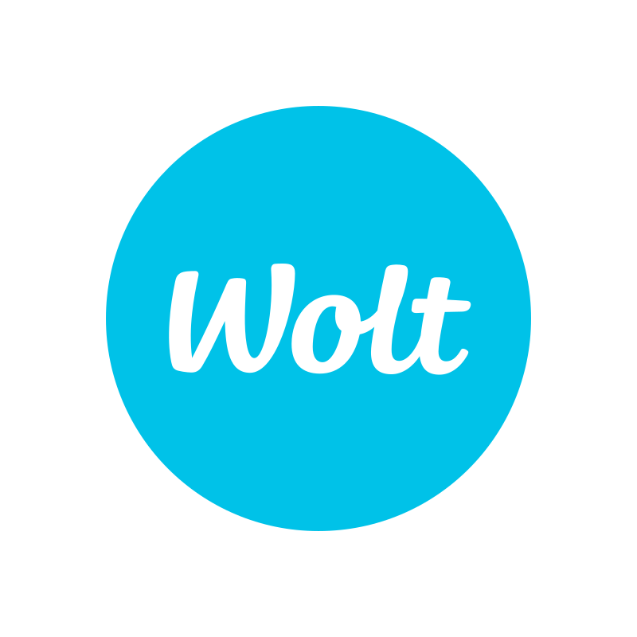
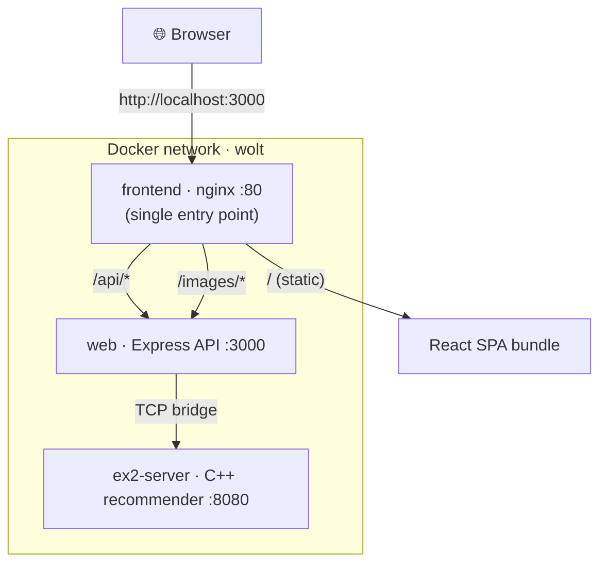
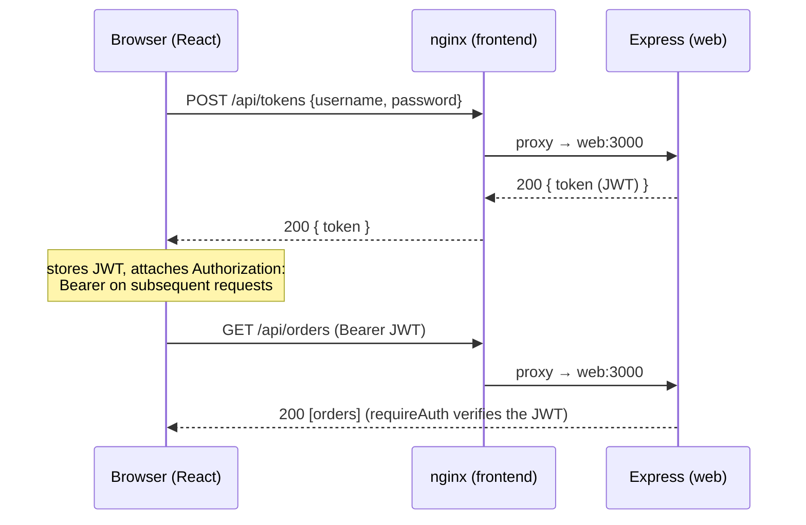
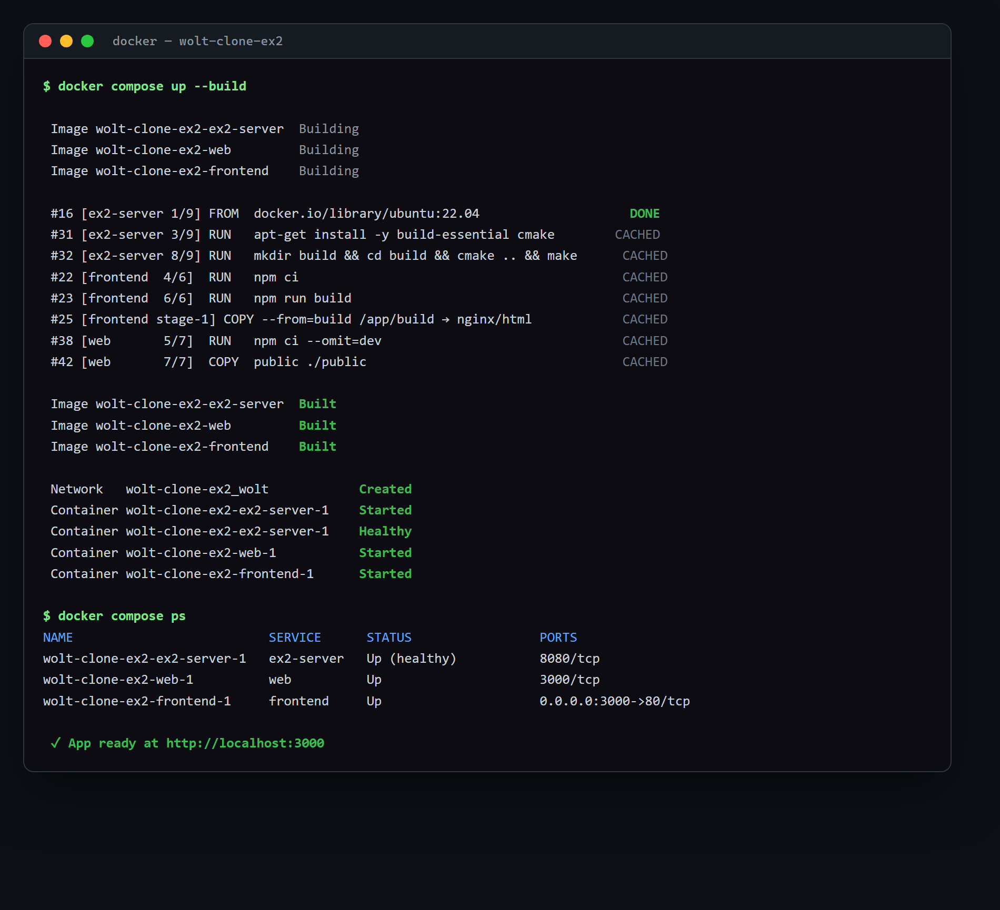
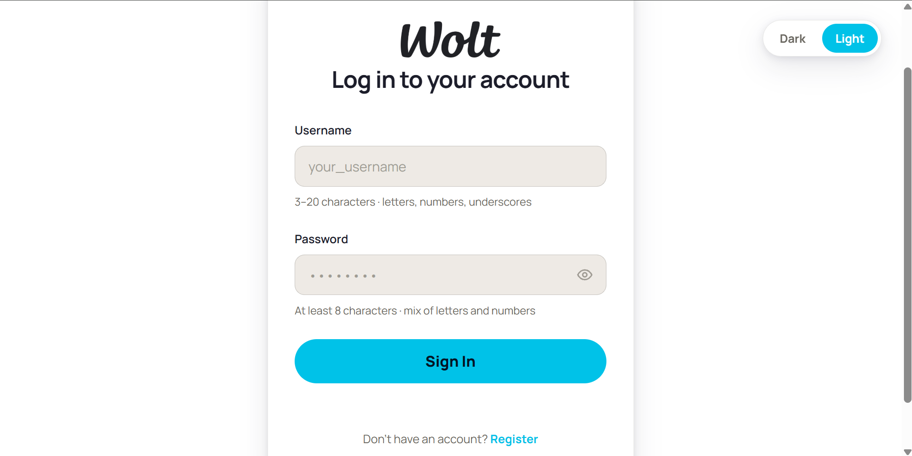
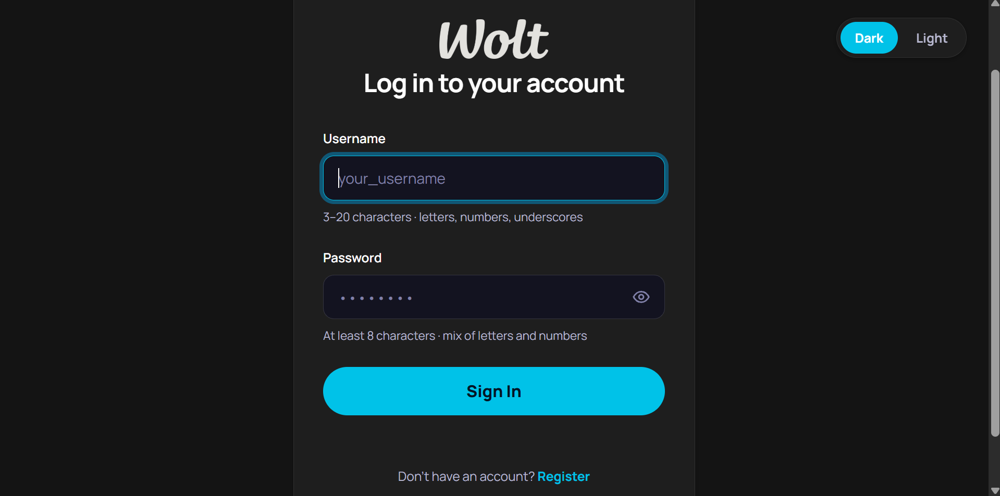
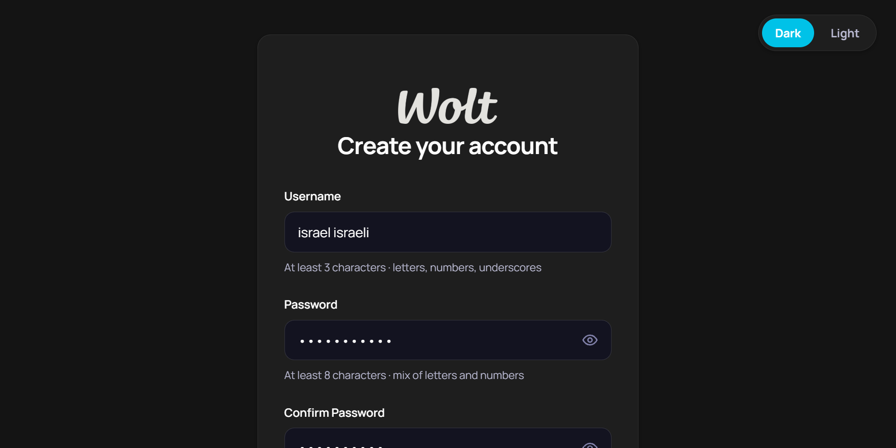
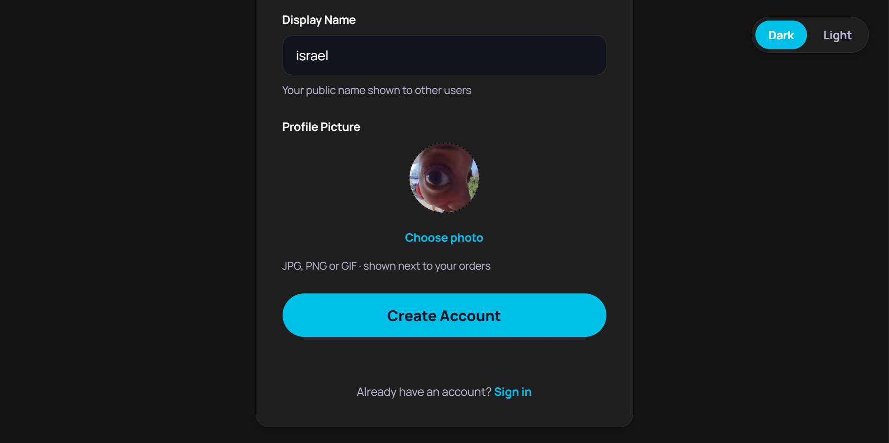
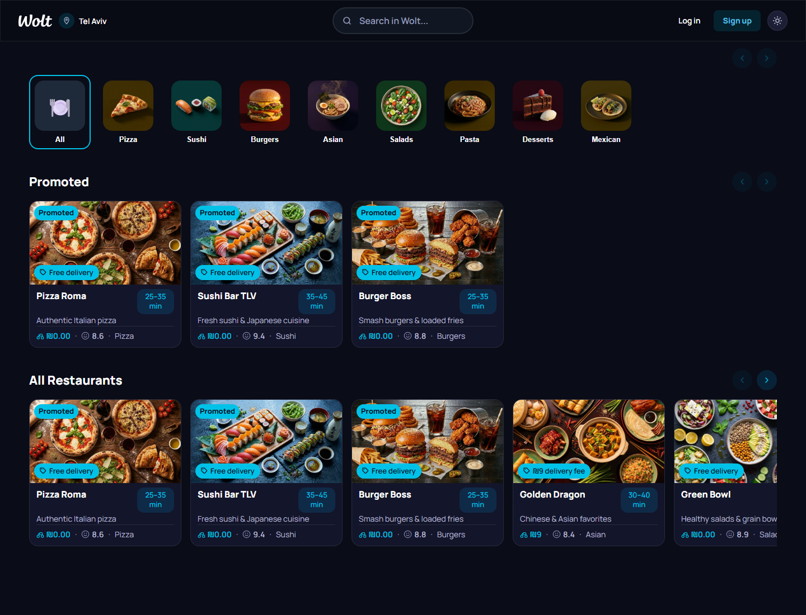
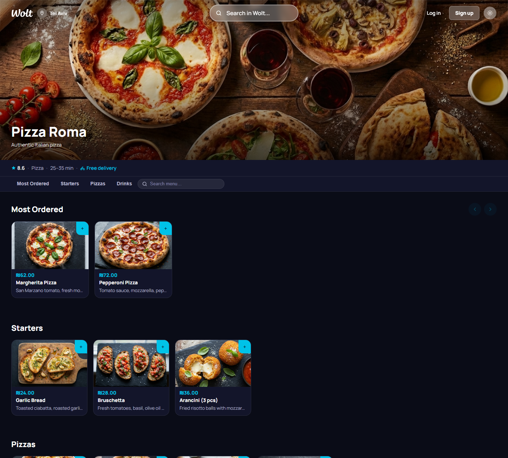

<div align="center">



# Wolt-Clone

**A full-stack food-delivery web app — React UI · Express API · C++ recommender, all in one `docker compose up`.**

[](https://react.dev/)
[](https://nodejs.org/)
[](https://expressjs.com/)
[](https://nginx.org/)
[](https://www.docker.com/)

[Quick Start](#quick-start-docker-compose) · [Features](#features) · [Architecture](#architecture) · [API](#api-reference) · [Demo](#demo--screenshots)

</div>

---

A **Wolt-style food-delivery application**. The UI is a **React single-page app** that talks to our **Node.js + Express** server (Ex3), which in turn bridges to the legacy **Ex2 C++ recommendation server** for personalized recommendations. The whole stack runs together with one command.

Everything the UI shows — restaurants, menus, orders, search results, recommendations — is **fetched live from the server**; nothing is hard-coded in the client. Registering a user, creating a restaurant, or placing an order all go through the API.

> [!NOTE]
> **Project history:** [Ex3 — Node/Express API server (MVC)](Ex3_README.md) — this app's backend, sources in `src/` · [Ex2 — C++ server + Python client](Ex2_README.md) · [Ex1 — CLI recommender](Ex1_README.md).

### Team

| Dana Sela | Roy Carmelli |
| :---: | :---: |

---

## Table of Contents

1. [Features](#features)
2. [Architecture](#architecture)
3. [Tech Stack](#tech-stack)
4. [Project Structure](#project-structure)
5. [Quick Start (Docker Compose)](#quick-start-docker-compose)
6. [Using the App](#using-the-app)
7. [API Reference](#api-reference)
8. [Demo & Screenshots](#demo--screenshots)
9. [Running Without Docker](#running-without-docker)
10. [Tests](#tests)
11. [Work Process & Project Management](#work-process--project-management)
12. [Notes & Limitations](#notes--limitations)

---

## Features

- **Authentication** — register & login with **client- and server-side validation**. On login the server returns a **JWT**, which the client attaches to every protected request (`Authorization: Bearer <token>`).
- **Protected pages** — checkout, profile, orders and the whole admin area are guarded by route guards on the client and JWT checks on the server; visiting them logged-out redirects to login.
- **Home screen** — nearby restaurants, promoted restaurants, and a **personalized "Recommended for you"** row (in-range restaurants ranked by the Ex2 C++ recommender), plus category filters.
- **Live search** — search restaurants and dishes from the top bar, with a dropdown and a full results page.
- **Restaurant page** — full menu grouped into sections, an item modal, and add-to-cart.
- **Cart & checkout** — a cart **persisted per user** across sessions, then a checkout that places a real order.
- **Orders** — view your past and current orders.
- **Profile** — view/update display name, picture and location.
- **Dark / light theme** — a top-bar toggle re-themes the whole app.
- **Admin area** — `admin` users can create/edit restaurants, manage menus, and view/update their restaurants' orders.

<p align="right"><a href="#table-of-contents">Back to top ↑</a></p>

---

## Architecture

The app runs as **three containers** on a private Docker network. Only the frontend is published to your machine — it is the **single entry point** and reverse-proxies API and image traffic to the backend internally.



| Container | Role | Listens (internal) | Published to host |
| :--- | :--- | :---: | :---: |
| `frontend` | React build served by **nginx** (single entry point) | `80` | **`3000` → `80`** |
| `web` | **Node.js + Express** API server (Ex3) | `3000` | — (internal) |
| `ex2-server` | Legacy **Ex2 C++** recommendation server (TCP) | `8080` | — (internal) |

Because the React client uses **relative URLs** (`/api/...`), the whole app is **single-origin** at `http://localhost:3000`: the home page returns the React app, and the API lives behind it at `/api`. nginx forwards `/api` and `/images` to `web`, and `web` reaches the C++ server as host `ex2-server`.

<details>
<summary><b>Request lifecycle — login then a protected call (sequence diagram)</b></summary>



</details>

<p align="right"><a href="#table-of-contents">Back to top ↑</a></p>

---

## Tech Stack

- **Frontend:** React 19, React Router 7, Bootstrap 5, Create-React-App build.
- **Backend:** Node.js + Express (MVC), JSON Web Tokens, in-memory data store.
- **Recommender:** C++ TCP server (Ex2), reached over a `node:net` bridge.
- **Serving / orchestration:** nginx (static + reverse proxy), Docker Compose.

---

## Project Structure

<details>
<summary>Repository layout</summary>

```text
.
├── docker-compose.yml         # Orchestrates all three containers (Ex4 entry point)
├── Dockerfile.web             # Node/Express API image
├── Dockerfile.server          # Ex2 C++ server image
├── frontend/                  # React single-page app
│   ├── Dockerfile             #   multi-stage: build with Node → serve with nginx
│   ├── nginx.conf             #   SPA fallback + /api and /images reverse proxy
│   └── src/
│       ├── App.js             #   routes (React Router)
│       ├── pages/             #   Home, Login, Register, Restaurant, Checkout,
│       │   └── admin/         #     Orders, Profile, SearchResults, + admin pages
│       ├── components/        #   AppBar, CartDrawer, route guards, cards, …
│       ├── api/               #   fetch wrappers (apiFetch attaches the JWT)
│       ├── hooks/ utils/      #   theme, cart storage, auth helpers, …
│       └── styles/ assets/
└── src/                       # Ex3 Node/Express server (backend)
    ├── app.js / server.js     #   Express app + bootstrap
    ├── routes/ controllers/   #   REST endpoints (users, tokens, restaurants,
    │                          #     products, orders, search)
    ├── middleware/auth.js     #   requireAuth / requireAdmin (JWT)
    ├── services/              #   in-memory repositories + TCP bridge to Ex2
    └── seed.js                #   seeds 8 restaurants with full menus on startup
```

The **Ex2 C++ server** sources live in the same repo (`src/Server`, `src/Logic`, …, `cpp-tests/`) and are documented in **[Ex2_README.md](Ex2_README.md)**.

</details>

<p align="right"><a href="#table-of-contents">Back to top ↑</a></p>

---

## Quick Start (Docker Compose)

This is the required way to run the project — one command builds and starts the whole stack.

> [!IMPORTANT]
> **Prerequisite:** **Docker Desktop** (or Docker Engine + Compose v2) installed and **running**. Nothing else is needed — Node, the C++ toolchain and nginx all live inside the images.

### 1. Build & start everything

From the repository root:

```bash
docker compose up --build
```

This single command **compiles all the code that needs compiling and starts all the servers**:

1. **`ex2-server`** — compiles the **C++** recommendation server with CMake/`make` inside the image, then runs it (TCP `:8080`, internal).
2. **`web`** — installs backend dependencies and starts the **Node/Express** API (`:3000`, internal). It waits until the C++ server is **healthy** before starting.
3. **`frontend`** — builds the **React** production bundle with Node, then serves it with **nginx**, published on **host `:3000`**.

> [!TIP]
> Add `-d` to run it detached (in the background): `docker compose up --build -d`.

### 2. Open the app

> **http://localhost:3000**

You should see the home screen with the seeded restaurants loaded from the server. See it in action under [Demo & Screenshots](#demo--screenshots).

### 3. Verify it's up

```bash
docker compose ps
```

```text
NAME                          SERVICE      STATUS                       PORTS
wolt-clone-ex2-ex2-server-1   ex2-server   Up (healthy)                 8080/tcp
wolt-clone-ex2-frontend-1     frontend     Up                           0.0.0.0:3000->80/tcp
wolt-clone-ex2-web-1          web          Up                           3000/tcp
```

Only `frontend` is published to the host; `web` and `ex2-server` are reachable only inside the Docker network. Quick endpoint checks:

```bash
curl -i http://localhost:3000/                       # 200 → the React app (index.html)
curl    http://localhost:3000/api/restaurants        # JSON list of restaurants (via nginx → web)
curl -I http://localhost:3000/images/restaurants/pizza-roma.jpg   # 200 image/jpeg (proxied)
```

### 4. Stop it

```bash
docker compose down
```

<details>
<summary><b>Configuration (environment variables)</b></summary>

| Variable | Used by | Default | Notes |
| :--- | :--- | :--- | :--- |
| `JWT_SECRET` | `web` | `wolt-clone-demo-jwt-secret` | Signs/verifies JWTs. Sourced from the host env / a local (gitignored) `.env` when present; otherwise the **non-sensitive demo** default is used so the stack runs out of the box. |
| `PORT` | `web` | `3000` | Internal API port. |
| `EX2_HOST` / `EX2_PORT` | `web` | `ex2-server` / `8080` | How the API reaches the C++ server on the Docker network. |

> [!CAUTION]
> No real secrets are committed. `JWT_SECRET` is only a local signing key for a demo with throwaway data — override it via your environment for any non-demo use.

</details>

<p align="right"><a href="#table-of-contents">Back to top ↑</a></p>

---

## Using the App

1. **Browse without logging in** — the home screen, search, and restaurant menus are public.
2. **Register** (`/register`) — pick a username, password, display name, profile picture and a location. Fields are validated both in the browser and on the server (a missing field or an existing username is rejected with a clear message).
3. **Log in** (`/login`) — on success you receive a JWT and gain access to the cart/checkout, orders and profile pages.
4. **Order** — open a restaurant, add items to the cart, and check out.
5. **Admin** — a user whose role is `admin` also sees the admin area (`/admin`) to manage restaurants, menus and incoming orders. New users default to `customer`.

<p align="right"><a href="#table-of-contents">Back to top ↑</a></p>

---

## API Reference

Base URL: `http://localhost:3000/api` — every response is JSON.

> [!NOTE]
> **Auth:** routes marked 🔒 require the JWT from `POST /api/tokens`, sent as `Authorization: Bearer <token>`. Routes marked 👑 additionally require the `admin` role. Missing/invalid tokens → `401`; non-admins on admin routes → `403`.

<details>
<summary><b>Users & authentication</b></summary>

| Method | Path | Auth | Description |
| :--- | :--- | :--: | :--- |
| `POST` | `/api/users` | — | Register — `username, password, displayName, profilePicture, location{lat,lng}` (all required) → `201 {id}`. `400` on missing fields or duplicate username. |
| `POST` | `/api/tokens` | — | Log in with `username` + `password` → `200 {token}` (`404` unknown user, `401` wrong password). |
| `GET` | `/api/users/:id` | — | Get a user's details (password never returned). |
| `PATCH` | `/api/users/:id` | 🔒 | Update your own profile → returns a refreshed `{user, token}`. |

</details>

<details>
<summary><b>Restaurants</b></summary>

| Method | Path | Auth | Description |
| :--- | :--- | :--: | :--- |
| `GET` | `/api/restaurants` | — | List all restaurants. |
| `GET` | `/api/restaurants/recommended` | 🔒 | Personalized restaurant recommendations for the logged-in user. |
| `POST` | `/api/restaurants` | 🔒👑 | Create a restaurant → `201 {id}`. |
| `GET` | `/api/restaurants/:id` | — | Get one restaurant. |
| `GET` | `/api/restaurants/:id/menu` | — | Get the restaurant's menu, grouped into sections. |
| `PATCH` | `/api/restaurants/:id` | 🔒👑 | Update a restaurant. |
| `DELETE` | `/api/restaurants/:id` | 🔒👑 | Delete a restaurant (cascades its products). |

</details>

<details>
<summary><b>Products (a restaurant's menu)</b></summary>

| Method | Path | Auth | Description |
| :--- | :--- | :--: | :--- |
| `GET` | `/api/restaurants/:id/products` | — | List the restaurant's products. |
| `GET` | `/api/restaurants/:id/products/recommended` | 🔒 | Recommended products for this restaurant. |
| `POST` | `/api/restaurants/:id/products` | 🔒 | Add a product → `201 {id}`. |
| `GET` | `/api/restaurants/:id/products/:pid` | — | Get a product — **also logs a view to the Ex2 server**. |
| `PATCH` | `/api/restaurants/:id/products/:pid` | 🔒 | Update a product. |
| `DELETE` | `/api/restaurants/:id/products/:pid` | 🔒 | Remove a product. |

</details>

<details>
<summary><b>Orders, search & health</b></summary>

| Method | Path | Auth | Description |
| :--- | :--- | :--: | :--- |
| `POST` | `/api/orders` | 🔒 | Create an order → `201` + `Location`. |
| `GET` | `/api/orders` | 🔒 | List the logged-in user's orders. |
| `GET` | `/api/orders/:id` | 🔒 | Get one order (`403` if it isn't yours). |
| `PATCH` | `/api/orders/:id` | 🔒 | Update an order. |
| `DELETE` | `/api/orders/:id` | 🔒 | Delete an order. |
| `PATCH` | `/api/orders/:id/status` | 🔒👑 | Update an order's status. |
| `GET` | `/api/orders/restaurant/:restaurantId` | 🔒👑 | All orders for a restaurant (admin view). |
| `GET` | `/api/search/:query` | — | Case-insensitive match → `{ restaurants: [...], products: [...] }`. |
| `GET` | `/api/health` | — | Liveness check → `200 {"status":"ok"}`. |

</details>

<p align="right"><a href="#table-of-contents">Back to top ↑</a></p>

---

## Demo & Screenshots

> [!NOTE]
> The **demo videos** below are real screen recordings of the running app. The still images show the Docker run and key screens; the cart, checkout, orders and admin flows are demonstrated in the videos.

### 🎥 Demo videos

Click ▶ on any clip to play it inline.

**▶ Happy flow** — browse restaurants → build a cart → checkout → see the order

https://github.com/user-attachments/assets/9ff6c47c-feea-4fc3-b908-873d04f29cad

**▶ Top bar** — live search, dark/light theme toggle, live location

https://github.com/user-attachments/assets/ec7de667-5697-42f2-8200-e58ed8ba570a

**▶ Register + create a restaurant** (admin)

https://github.com/user-attachments/assets/752a0366-0608-428a-98b5-f0e0211d23d7

**▶ Admin features** — manage menus & restaurant orders

https://github.com/user-attachments/assets/a3c95300-cd66-4a4d-a8d8-52a7f990ccac

**▶ Promote a customer to admin**

https://github.com/user-attachments/assets/a095bb96-02e4-4b0e-b634-0b9c5c842c10


### 🖥️ Running with Docker



### 🔐 Login — light & dark theme

The top-bar toggle re-themes the entire app.

| Light | Dark |
| :---: | :---: |
|  |  |

### 📝 Register — with validation

Required fields, password rules, profile picture and location, with clear inline feedback.

| Top | Bottom |
| :---: | :---: |
|  |  |

### 🏠 Home · 🍽️ Restaurant

| Home — nearby, promoted & recommended | Restaurant — full menu |
| :---: | :---: |
|  |  |

> [!TIP]
> Cart & checkout, orders, and the full admin area (manage restaurants, menus & orders) are shown end-to-end in the **demo videos** above.

<p align="right"><a href="#table-of-contents">Back to top ↑</a></p>

---

## Running Without Docker

<details>
<summary>Development workflow (three processes)</summary>

Useful for fast iteration on the frontend.

```bash
# 1) Ex2 C++ server (build once with CMake — see Ex2_README.md)
mkdir build && cd build && cmake .. && make && ./WoltClone 8080

# 2) Node/Express API (point it at the local C++ server)
#    Linux/macOS:
EX2_HOST=127.0.0.1 EX2_PORT=8080 PORT=3000 JWT_SECRET=dev-secret npm start
#    Windows PowerShell:
#    $env:EX2_HOST='127.0.0.1'; $env:EX2_PORT=8080; $env:PORT=3000; $env:JWT_SECRET='dev-secret'; npm start

# 3) React dev server (proxies /api to :3000 — see frontend/package.json "proxy")
cd frontend && npm install && npm start
```

> [!NOTE]
> Since the API already holds port `3000`, the CRA dev server starts on the next free port (it offers **`http://localhost:3001`**) and proxies `/api` calls to the Express server on `:3000`. In the Docker build, nginx plays that proxy role instead — which is why the containerized app is single-origin on `:3000`.

</details>

---

## Tests

```bash
# Backend — node:test (repositories, app, TCP bridge)
npm test

# Frontend — React Testing Library / Jest (watch mode; prefix CI=true to run once)
cd frontend && CI=true npm test
```

---

## Work Process & Project Management

Developed with **Agile Scrum**, tracked in **JIRA**:

- Work is split into **epics → user stories → subtasks**; each is assigned before work begins and built on a **feature branch** whose name contains the JIRA issue key (e.g. `SCRUM-276-docker-and-readme`), which auto-links the branch and PR to the issue.
- **Feature-branch workflow:** every change merges into `main` only through a **pull request reviewed and approved by another team member** — the approver is never the author. Status moves `In Progress → Code Review → Done` on the board, and blockers are tracked with *is blocked by* links.
- **Status meetings** are held through the sprint and their decisions recorded in JIRA.
- **Test-driven where it applies** — the data layer, the TCP bridge and many React components ship with tests.

This Ex4 sprint ("UI for Wolt App") added the React frontend on top of the Ex3 API and containerized the whole stack.

<p align="right"><a href="#table-of-contents">Back to top ↑</a></p>

---

## Notes & Limitations

> [!NOTE]
> **In-memory store:** all data is volatile and resets when the `web` container restarts. On startup the server **seeds 8 restaurants with full menus** so the app is populated immediately.

> [!WARNING]
> **No secrets:** this is a teaching exercise — do not store or send real passwords, cards, tokens or keys. `JWT_SECRET` is a throwaway demo value.

**Allowed tooling only:** React/JS/CSS/Bootstrap on the client, Node.js + Express on the server, plus standard infrastructure (nginx, Docker).

<p align="right"><a href="#table-of-contents">Back to top ↑</a></p>
</content>
