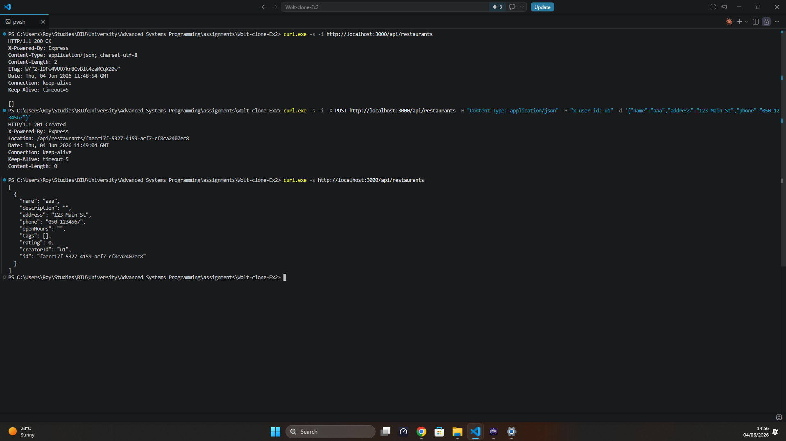
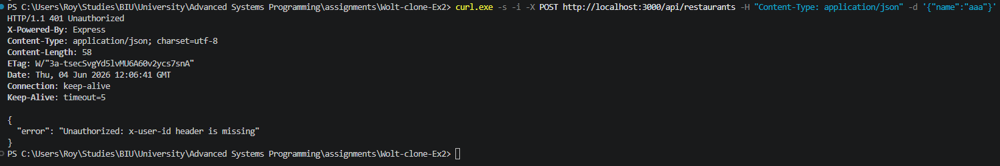
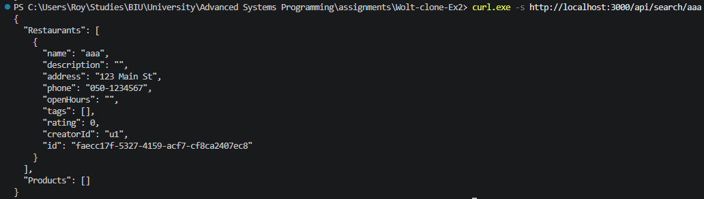
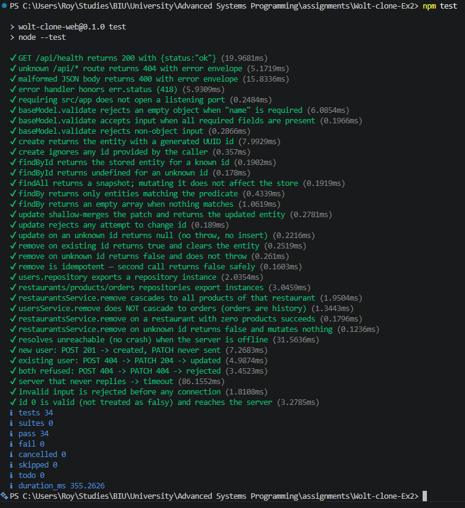

# Wolt-Clone — Ex3: Node.js + Express Web Server (MVC)

[](https://nodejs.org/)
[](https://expressjs.com/)
[](https://www.docker.com/)
[](https://nodejs.org/api/test.html)

A RESTful food-delivery web server (Wolt-style) built in **Node.js + Express**
with an **MVC** architecture. It exposes the application's core API — users,
authentication, restaurants, menus, orders, and search — and also acts as a
**TCP client to the legacy Ex2 C++ recommendation server**, logging product
views so the recommender can learn from them.

All `/api/*` endpoints return **JSON** (this is a web service, not an HTML app).
Data is kept **in memory** — restarting the server clears everything.

> **Project history:** [Ex2 — C++ server + Python client](Ex2_README.md) ·
> [Ex1 — CLI recommender](Ex1_README.md).

---

## Team Members

| Name |
| :--- |
| **Dana Sela** |
| **Roy Carmelli** |

---

## Architecture

The server follows **MVC** with **loose coupling** and **SOLID** in mind, so new
endpoints and the future swap of the in-memory store for a database plug in as
*extensions* rather than rewrites.

```text
HTTP client (curl / Postman / browser)
      │  JSON over HTTP  (:3000)
      ▼
Express app  (src/app.js)
      ▼
Routes  (src/routes/*)            ── URL → controller mapping
      ▼
Middleware  (src/middleware/*)    ── auth (x-user-id), JSON errors, 404
      ▼
Controllers  (src/controllers/*)  ── request handling, status codes
      ▼
Services / Repositories           ── in-memory data (src/services/*)
      │
      └──► TCP bridge  (src/services/tcpClient.js)
                 │  newline TCP protocol  (:8080)
                 ▼
           Ex2 C++ recommendation server   (separate process/container)
```

**Layers**

- **Routes** (`src/routes/`) — map each URL + method to a controller; attach the
  `requireAuth` middleware to protected routes.
- **Middleware** (`src/middleware/`) — `auth.js` enforces the `x-user-id` header
  on protected routes; `errorHandler.js` / `notFound.js` keep every response a
  clean JSON envelope.
- **Controllers** (`src/controllers/`) — validate input, call the data layer,
  return the correct HTTP status.
- **Services / Repositories** (`src/services/`) — the in-memory store behind a
  small repository interface (`baseRepository.js`), so the storage backend can be
  swapped without touching controllers.
- **Bridge** (`src/services/tcpClient.js`) — a thin, resilient `node:net` client
  to the Ex2 C++ server. It never throws/rejects: if that server is down or slow,
  the web request is unaffected (see [Ex2 integration](#ex2-integration)).

---

## Project Structure (Ex3 web server)

```text
src/
├── server.js              # Boots the HTTP server (reads PORT)
├── app.js                 # Express app: JSON parsing, routes, error handling
├── config/
│   └── env.js             # PORT, EX2_HOST, EX2_PORT (from environment)
├── routes/                # users, tokens, restaurants, products, orders, search
├── middleware/
│   ├── auth.js            # requireAuth — validates the x-user-id header
│   ├── errorHandler.js
│   └── notFound.js
├── controllers/           # one controller per resource
├── services/
│   ├── repositories/      # in-memory CRUD (baseRepository + per-entity repos)
│   ├── tcpClient.js       # TCP bridge to the Ex2 C++ server
│   └── *.service.js       # cross-entity orchestration (e.g. cascading deletes)
└── models/                # input validation helpers
web-tests/                 # node:test unit tests (repositories, app, tcpClient)
Dockerfile.web             # Node web-server image
Dockerfile.server          # Ex2 C++ server image (see Ex2_README.md)
docker-compose.yml         # Runs web + ex2-server together
```

The **Ex2 C++ server** sources live in the same repo (`src/Server`, `src/Commands`,
`src/Logic`, …, `cpp-tests/`) and are documented in **[Ex2_README.md](Ex2_README.md)**.

---

## API Reference

Base URL: `http://localhost:3000/api` — every response is JSON.

**Authentication:** some actions require a logged-in user. Pass the user's id as
the **`x-user-id`** HTTP header on protected routes (marked 🔒). Missing it
returns `401 Unauthorized`.

### Users & authentication
| Method | Path | Auth | Description |
| :--- | :--- | :--: | :--- |
| `POST` | `/api/users` | — | Register a user — `name, phone, address, email, password` (all required) → `201 {id}` |
| `GET` | `/api/users/:id` | — | Get a user's details (password is never returned) |
| `POST` | `/api/tokens` | — | Log in with `email` + `password` → `200 {id}` (`404` unknown email, `401` wrong password) |

### Restaurants
| Method | Path | Auth | Description |
| :--- | :--- | :--: | :--- |
| `GET` | `/api/restaurants` | — | List all restaurants |
| `POST` | `/api/restaurants` | 🔒 | Create a restaurant (`name, address, phone` required) → `201 {id}` |
| `GET` | `/api/restaurants/:id` | — | Get one restaurant |
| `PATCH` | `/api/restaurants/:id` | 🔒 | Update a restaurant |
| `DELETE` | `/api/restaurants/:id` | 🔒 | Delete a restaurant (cascades its products) |

### Products (a restaurant's menu)
| Method | Path | Auth | Description |
| :--- | :--- | :--: | :--- |
| `GET` | `/api/restaurants/:id/products` | — | List the restaurant's menu |
| `POST` | `/api/restaurants/:id/products` | 🔒 | Add a product (`name, price, category` required) → `201 {id}` |
| `GET` | `/api/restaurants/:id/products/:pid` | — | Get a product — **also logs a view to the Ex2 server** |
| `PATCH` | `/api/restaurants/:id/products/:pid` | 🔒 | Update a product |
| `DELETE` | `/api/restaurants/:id/products/:pid` | 🔒 | Remove a product |

### Orders
| Method | Path | Auth | Description |
| :--- | :--- | :--: | :--- |
| `POST` | `/api/orders` | 🔒 | Create an order — body `{ restaurantId, items: [{ productId, quantity }] }` → `201` + `Location` |
| `GET` | `/api/orders` | 🔒 | List the logged-in user's orders |
| `GET` | `/api/orders/:id` | 🔒 | Get one order (`403` if it isn't yours) |
| `PATCH` | `/api/orders/:id` | 🔒 | Update an order |
| `DELETE` | `/api/orders/:id` | 🔒 | Delete an order |

### Search
| Method | Path | Auth | Description |
| :--- | :--- | :--: | :--- |
| `GET` | `/api/search/:query` | — | Case-insensitive name/description match → `{ "Restaurants": [...], "Products": [...] }` |

### Health
| Method | Path | Auth | Description |
| :--- | :--- | :--: | :--- |
| `GET` | `/api/health` | — | Liveness check → `200 {"status":"ok"}` |

**Status codes:** `200` OK · `201` Created (orders also return a `Location`
header; restaurants/products return the new `{id}`) · `204` No Content · `400`
Bad Request (missing/invalid fields) · `401` Unauthorized (missing `x-user-id`)
· `403` Forbidden (another user's order) · `404` Not Found.

---

## Ex2 integration

Some actions must reach the **Ex2 C++ recommendation server** (a raw-TCP,
line-based protocol — not HTTP). The web server opens a socket to it as a client.

The clearest example: **`GET /api/restaurants/:id/products/:pid`** records that
the user viewed the product by sending `POST <userId> <productId>` to the Ex2
server (falling back to `PATCH` if the user already exists). This is handled by
[`src/services/tcpClient.js`](src/services/tcpClient.js) and is **fire-and-forget
and crash-proof**: if the Ex2 server is unreachable or slow, the HTTP response is
unaffected. The target server is configured with `EX2_HOST` / `EX2_PORT`.

---

## How to Run

### Option 1 — Docker Compose (recommended)

Runs the web server and the Ex2 C++ server as **two containers** on a shared
network — exactly as the assignment requires.

**Prerequisite:** Docker (Desktop or Engine) running.

```bash
docker compose up --build
```

| Service | URL / port |
| :--- | :--- |
| `web` (Node web server) | `http://localhost:3000` |
| `ex2-server` (C++ server) | TCP `localhost:8080` |

The web server reaches the C++ server by the hostname `ex2-server` over the
internal network (no host config needed). Stop with:

```bash
docker compose down
```

### Option 2 — Standalone (no Docker)

Run the two servers in two terminals.

**Terminal 1 — Ex2 C++ server** (build once with CMake — details in
[Ex2_README.md](Ex2_README.md)):

```bash
mkdir build && cd build && cmake .. && make
./WoltClone 8080
```

**Terminal 2 — Node web server** (point it at the local C++ server):

```bash
npm install
# Linux/macOS:
EX2_HOST=127.0.0.1 EX2_PORT=8080 PORT=3000 npm start
# Windows PowerShell:
#   $env:EX2_HOST='127.0.0.1'; $env:EX2_PORT=8080; $env:PORT=3000; npm start
```

The web API is then at `http://localhost:3000`.

> **Environment variables:** `PORT` (web port, default `3000`), `EX2_HOST`
> (default `ex2-server`, the Docker service name), `EX2_PORT` (default `8080`).
> When running standalone, set `EX2_HOST=127.0.0.1` so the bridge finds the local
> C++ server.

### Run the tests

```bash
npm test          # node:test — repositories, app, and the TCP bridge (web-tests/)
```

---

## Example walk-through (curl)

A short session against a freshly started server. Real responses shown.

```bash
# 1) List restaurants — open endpoint, empty on a fresh start.
$ curl -s -i http://localhost:3000/api/restaurants
HTTP/1.1 200 OK
[]

# 2) Create a restaurant WITHOUT logging in — rejected.
$ curl -s -i -X POST http://localhost:3000/api/restaurants \
    -H "Content-Type: application/json" -d '{"name":"aaa"}'
HTTP/1.1 401 Unauthorized
{"error":"Unauthorized: x-user-id header is missing"}

# 3) Create it correctly — auth header + required fields.
$ curl -s -i -X POST http://localhost:3000/api/restaurants \
    -H "Content-Type: application/json" -H "x-user-id: u1" \
    -d '{"name":"aaa","address":"123 Main St","phone":"050-1234567"}'
HTTP/1.1 201 Created

# 4) Read it back.
$ curl -s http://localhost:3000/api/restaurants
[{"name":"aaa","address":"123 Main St","phone":"050-1234567", ... ,"id":"<uuid>"}]

# 5) Add a product, then view it (this also logs a view to the Ex2 server).
$ curl -s -X POST http://localhost:3000/api/restaurants/<id>/products \
    -H "Content-Type: application/json" -H "x-user-id: u1" \
    -d '{"name":"prod","price":10,"category":"main"}'
$ curl -s -i http://localhost:3000/api/restaurants/<id>/products/<pid> -H "x-user-id: u1"
HTTP/1.1 200 OK

# 6) Search by name/description.
$ curl -s http://localhost:3000/api/search/aaa
{"Restaurants":[ ... ],"Products":[ ... ]}
```

---

## Screenshots

> _Capture these from a running stack (`docker compose up --build`) and drop the
> images into `screenshots/`. Replace each placeholder below._

### Server running (Docker)
<!-- Capture: `docker compose up` showing ex2-server "Healthy" then web started. -->


### Restaurants flow (GET → POST → GET)
<!-- Capture: a terminal running the curl example above (200 [] → 401 → 201 → list). -->


### Auth enforcement (401)
<!-- Capture: a protected POST without x-user-id returning 401. -->


### Search
<!-- Capture: GET /api/search/:query returning {Restaurants, Products}. -->


### Tests passing
<!-- Capture: `npm test` output. -->


---

## Version control — Ex2 vs Ex3

- **Ex3** (this Node/Express web server) is developed on **`main`** via feature
  branches merged through reviewed pull requests.
- **Ex2** (the C++ server + Python client) is **frozen for grading** at tag
  **`ex2-submission`** and branch **`submission/ex2`**, and is never modified by
  Ex3 work — so the two submissions never mix.

To inspect the Ex2 submission:

```bash
git checkout ex2-submission      # or: git checkout submission/ex2
```

Ex2 is documented separately in **[Ex2_README.md](Ex2_README.md)**.

---

## Project Management

Developed with **Agile Scrum**, tracked in **JIRA**:

- Work is split into epics, user stories, and subtasks; each is assigned before
  work begins and built on a **feature branch** whose name contains the JIRA
  issue key, which auto-links the branch to the issue.
- **Feature-branch workflow:** every change merges into `main` only through a
  **pull request** reviewed and approved by another team member (the approver is
  never the author).
- **Test-driven** where it applies — the data layer and the TCP bridge ship with
  `node:test` suites written before the implementation.

---

## Notes & limitations

- **In-memory only:** all data is volatile and resets when the web server
  restarts (per the assignment).
- **No secrets:** this is a teaching exercise; do not store or send real
  passwords, cards, tokens, or keys.
- **Allowed tooling:** Node.js + Express only (plus Node built-ins).
