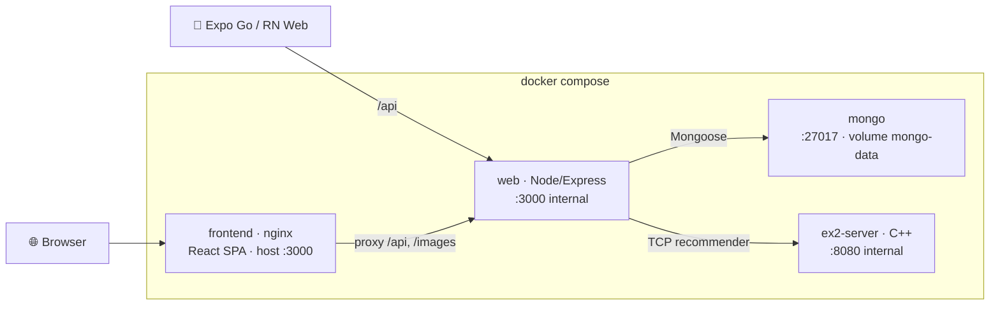

# 🚀 Environment Setup — Bringing Up the Whole Stack

Bring up **every part of the system together** — the C++ recommender, MongoDB, the Node/Express API, the React web client, and the React Native mobile client — and verify each piece came up correctly.

**At a glance:** one command (`docker compose up --build`) starts 4 containers; the mobile app runs separately and talks to the same API.

## Architecture



| Service | Role | Port | Notes |
| --- | --- | --- | --- |
| `ex2-server` | Ex2 C++ recommendation engine | `8080` (internal) | compiled with CMake inside the image |
| `mongo` | MongoDB | `27017` (host-published) | persists to the `mongo-data` volume |
| `web` | Node/Express API (Mongo-backed) | `3000` (internal) | `MONGO_URI=mongodb://mongo:27017/wolt_db`; waits for `ex2-server` **healthy** |
| `frontend` | React web app + nginx | **`3000` (host)** | the only service published to the host; proxies `/api` & `/images` to `web` |

The **mobile app** (Ex5) is not containerized — it talks to the same `web` API over the LAN / emulator network.

## 1. Prerequisites

> [!IMPORTANT]
> **Docker Desktop** (or Docker Engine + Compose v2), running. For the mobile client you also need **Node.js** and either the **Expo Go** app on your phone or an Android/iOS emulator.

## 2. Build & start the backend + web stack

From the repository root:

```bash
docker compose up --build
```

This one command compiles the C++ recommender, installs the Node server's dependencies, builds the React production bundle, and starts all four services in order (`mongo` and `ex2-server` first, then `web`, then `frontend`).

> [!TIP]
> Add `-d` to run detached: `docker compose up --build -d`.

> 🎥 **Capture — `flow-bringup.mp4`** ([guide V1](00-Media-Capture-Guide.md#-videos-headline-flows))
> **Record:** run `docker compose up --build`, wait for services to start, then `docker compose ps`, then open the app and see restaurants load. ~30s.

> 📷 **Capture — `env-compose-up.png`** ([guide E1](00-Media-Capture-Guide.md#-environment)) · desktop / terminal
> **Show:** the `docker compose up --build` output with all 4 services started.

## 3. Verify every service is up

```bash
docker compose ps
```

```text
NAME                          SERVICE      STATUS                       PORTS
wolt-clone-ex2-ex2-server-1   ex2-server   Up (healthy)                 8080/tcp
wolt-clone-ex2-mongo-1        mongo        Up                           0.0.0.0:27017->27017/tcp
wolt-clone-ex2-web-1          web          Up                           3000/tcp
wolt-clone-ex2-frontend-1     frontend     Up                           0.0.0.0:3000->80/tcp
```

Endpoint checks (through the nginx proxy on `:3000`):

```bash
curl -i http://localhost:3000/                              # 200 → React app (index.html)
curl    http://localhost:3000/api/restaurants                # JSON list of seeded restaurants (from Mongo)
curl -I http://localhost:3000/images/restaurants/pizza-roma.jpg  # 200 image/jpeg (proxied)
```

A non-empty `restaurants` array confirms the seed script (`src/seed.js`) ran and Mongo is backing the API — see [Backend: Restaurants & Products](08-Backend-Restaurants-Products.md) for what gets seeded.

> 📷 **Capture — `env-compose-ps.png`** ([guide E2](00-Media-Capture-Guide.md#-environment)) · desktop / terminal
> **Show:** `docker compose ps` with `ex2-server` healthy and `mongo` / `web` / `frontend` up.

## 4. Run the mobile app against the stack

The Expo app is a separate client you run alongside the stack:

```bash
cd mobile
npm install     # first time only
npm start       # expo start — shows a QR code + a menu of options
```

From the Expo CLI menu:
- Press **`a`** for a connected Android emulator/device.
- Press **`i`** for an iOS simulator (macOS only).
- Press **`w`** for the browser via React Native Web (`npm run web`).
- Or scan the QR code with **Expo Go** (phone and computer on the same Wi-Fi).

The app resolves the API base URL automatically:

| Where it runs | API base URL |
| --- | --- |
| Physical device (Expo Go) | `http://<your-computer-LAN-IP>:3000/api` |
| Android emulator | `http://10.0.2.2:3000/api` |
| iOS simulator / web | `http://localhost:3000/api` |

> [!NOTE]
> The mobile app talks to `web` on port `3000` — the same `:3000` the `frontend`/nginx service publishes and proxies `/api` through, so no extra setup is needed while the compose stack is up.

> 📷 **Capture — `env-expo-connected.png`** ([guide E3](00-Media-Capture-Guide.md#-environment)) · phone · light
> **Show:** Expo Go running the app with restaurants loaded — proves the mobile client reaches the backend.

## 5. Stop everything

```bash
docker compose down          # stop & remove containers
docker compose down -v       # also drop the mongo-data volume (wipes all data)
```

---

↩ [Wiki index](README.md) · Next: [Home & Browsing](02-Home-and-Browsing.md)
