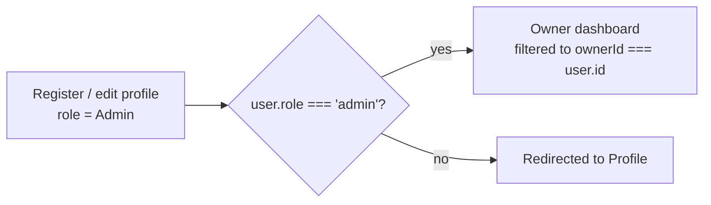

# 🧑‍🍳 Owner Dashboard (Mobile)

The restaurant owner's home base — manage the restaurants you own.

**At a glance:** for **admins (owners)** only · Owner tab · route `mobile/src/app/owner/index.tsx`.

## Role-gating

The Owner tab is only usable for accounts with role `admin`:

An owner only ever sees and manages restaurants where `ownerId === user.id`.

## What you see

- **Restaurant cards** for each owned restaurant: image, name, category, and rating / delivery-time / delivery-fee pills.
- **Primary actions:** "View page" (customer-facing [menu](04-Restaurant-Menu.md)) and "Orders" (incoming orders).
- **Expandable actions:** Edit · Menu · Delete (double-confirm) — see [Restaurant CRUD](06-Restaurant-CRUD.md) and [Dish CRUD](07-Dish-CRUD.md).
- **Empty state:** "Grow Your Business" prompt with a "Create Restaurant" call-to-action.
- **FAB ("Add Restaurant"):** an animated floating button that collapses to an icon on scroll.

## Walkthrough

1. Log in as (or register) a user with the `admin` role.
2. Open the **Owner** tab — confirm only your restaurants appear.
3. Expand a card and confirm Edit / Menu / Delete / Orders are reachable.
4. Log in as a non-admin user and confirm the Owner tab is inaccessible.

## Media

> 📷 **Capture — `owner-dashboard.png`** ([guide O1](00-Media-Capture-Guide.md#-owner-tools-dashboard--restaurant-crud--dish-crud)) · phone · light
> **Show:** the owner dashboard listing owned restaurants.

> 📷 **Capture — `owner-card-actions.png`** ([guide O2](00-Media-Capture-Guide.md#-owner-tools-dashboard--restaurant-crud--dish-crud)) · phone · light
> **Show:** an expanded restaurant card showing Edit / Menu / Delete.

> 📷 **Capture — `owner-empty.png`** ([guide O3](00-Media-Capture-Guide.md#-owner-tools-dashboard--restaurant-crud--dish-crud)) · phone · light
> **Show:** the empty state ("Grow Your Business") for an owner with no restaurants.

---

↩ [Wiki index](README.md) · Next: [Restaurant CRUD](06-Restaurant-CRUD.md)
