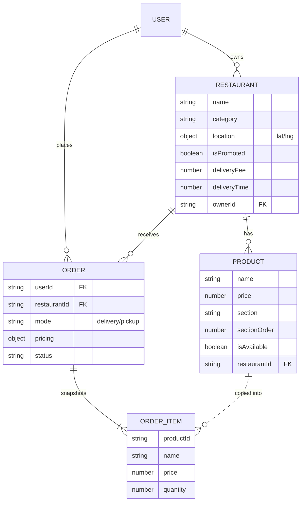
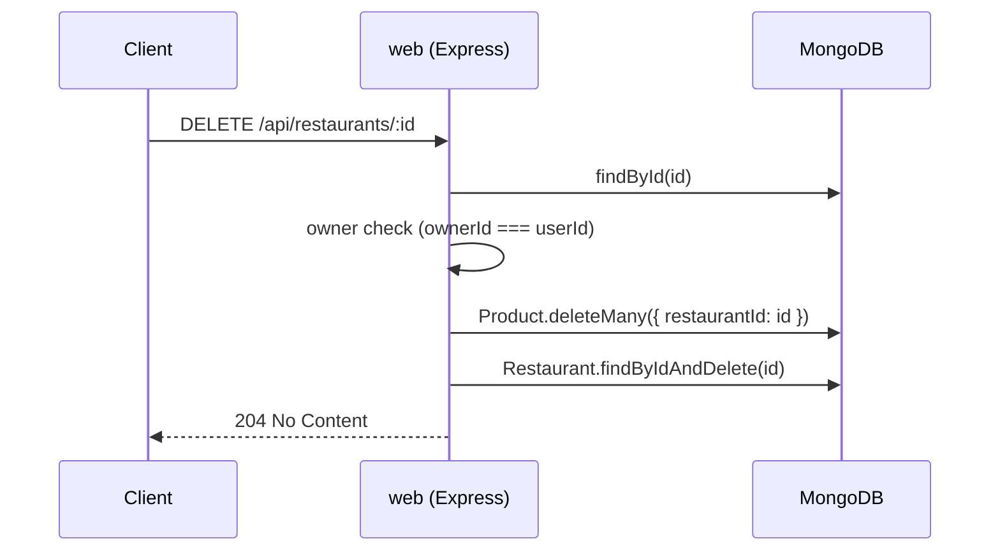

# 🗄️ Backend: Restaurants & Products

How the restaurants and menu items are stored and served. All persistence is on MongoDB via Mongoose — controllers call the models directly (no repository layer), the same pattern the users slice uses.

## Data model

The whole app's data model — this page owns **Restaurant** and **Product**; [Users & Orders](13-Backend-Users-Orders.md) owns **User** and **Order**.



> Order items are a **snapshot** copied into the order at checkout, so a later price change or a deleted product never rewrites past orders.

## Mongoose schemas

**`src/models/Restaurant.js`**

| Field | Type | Notes |
| --- | --- | --- |
| `name` | String | required |
| `description` | String | default `''` |
| `location.lat` / `location.lng` | Number | both required |
| `category` | String | required |
| `phone`, `openHours` | String | default `''` |
| `isPromoted` | Boolean | default `false` — drives the [Home carousel](02-Home-and-Browsing.md) |
| `rating` | Number | default `0` |
| `image` | String | base64 data URI or path |
| `deliveryFee` | Number | default `0` |
| `deliveryTime` | Number | default `30` |
| `ownerId` | String | required — the creating user's id, used for owner-only checks |

**`src/models/Product.js`**

| Field | Type | Notes |
| --- | --- | --- |
| `name` | String | required |
| `description` | String | default `''` |
| `price` | Number | required |
| `section` | String | required — groups items in the menu (e.g. "Mains") |
| `sectionOrder` | Number | default `2` — controls section ordering, updated by drag-to-reorder |
| `isAvailable` | Boolean | default `true` |
| `image` | String | base64 data URI or path |
| `restaurantId` | String | required — the canonical FK |

Both use `{ timestamps: true, toJSON: { virtuals: true } }`, so responses expose Mongoose's `.id` virtual (a string of `_id`) rather than a raw `_id`.

## REST routes

**`src/routes/restaurants.routes.js`**

| Method | Path | Auth | Notes |
| --- | --- | --- | --- |
| GET | `/api/restaurants` | — | optional `?lat=&lng=` filters to a 15 km radius |
| POST | `/api/restaurants` | admin | `ownerId` set from the authenticated user |
| GET | `/api/restaurants/recommended` | auth | |
| GET | `/api/restaurants/:id` | — | |
| GET | `/api/restaurants/:id/menu` | — | groups products into sections, sorted by `sectionOrder` |
| PATCH | `/api/restaurants/:id` | admin + owner | 403 if `restaurant.ownerId !== req.userId` |
| DELETE | `/api/restaurants/:id` | admin + owner | 403 if not the owner; cascades (see below) |

**`src/routes/products.routes.js`** (mounted at `/api/restaurants/:id/products`)

| Method | Path | Auth | Notes |
| --- | --- | --- | --- |
| GET | `/` | — | all products for the restaurant |
| POST | `/` | auth | |
| GET | `/recommended` | auth | |
| GET | `/:pid` | — | |
| PATCH | `/:pid` | auth | |
| DELETE | `/:pid` | auth | |

## Cascade delete

Deleting a restaurant removes its products first, so no orphaned menu items are left behind:



`src/services/restaurants.service.js`:

```javascript
async function remove(id) {
    const restaurant = await Restaurant.findById(id);
    if (!restaurant) return false;

    await Product.deleteMany({ restaurantId: id });
    await Restaurant.findByIdAndDelete(id);

    return true;
}
```

Shown end-to-end in [Restaurant CRUD](06-Restaurant-CRUD.md).

## Search

`src/controllers/search.controller.js` queries both collections in parallel, case-insensitively:

```javascript
const [restaurants, products] = await Promise.all([
    Restaurant.find({ $or: [{ name: regex }, { description: regex }, { category: regex }] }),
    Product.find({ $or: [{ name: regex }, { description: regex }] }),
]);
```

Used by the mobile [Search](03-Search.md) screen via `GET /api/search/:query`.

## Seed data

`src/seed.js` runs on server start if `Restaurant.countDocuments() === 0`, seeding **8 restaurants** (Pizza Roma, Sushi Bar TLV, Burger Boss, Golden Dragon, Green Bowl, The Pasta House, Sweet Dreams, Taco Fiesta), each with 3–5 menu sections and 8–15 items — roughly **80 products**, all with `ownerId: 'system'`.

## Try it

```bash
# after `docker compose up --build` (see Environment Setup)
curl http://localhost:3000/api/restaurants | jq 'length'         # 8
curl http://localhost:3000/api/restaurants/<id>/menu | jq '.[0]'  # first menu section
curl http://localhost:3000/api/search/pizza | jq '.restaurants | length'
```

---

↩ [Wiki index](README.md) · Related: [Restaurant CRUD](06-Restaurant-CRUD.md) · [Dish CRUD](07-Dish-CRUD.md)
