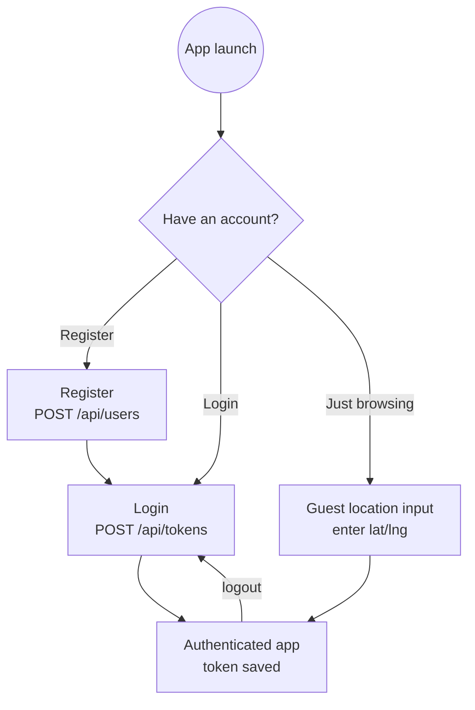

# 🔐 Authentication & Profile (Mobile)

Registration, login, guest browsing, and profile management — the entry point to the app.

**At a glance:** for **everyone** · routes under `mobile/src/app/user/` + the Profile tab · JWT stored in `AsyncStorage`.

## Registration

Route: `mobile/src/app/user/register.tsx`. Fields (all validated before submit):

| Field | Notes |
| --- | --- |
| Username | required, unique (server rejects duplicates) |
| Password + Confirm | required, ≥ 8 chars; visibility toggle |
| Display name | required |
| Profile picture | image picker → base64 data URI, required |
| Location (lat/lng) | required, numeric |
| Role | toggle **Customer** / **Admin** (admins get the [owner tools](05-Owner-Dashboard.md)) |

On submit: `POST /api/users`. The server enforces unique username + password length, and defaults role to `customer`.

## Login

Route: `mobile/src/app/user/login.tsx`. Username + password (eye toggle). Success → `POST /api/tokens` returns `{ token, user }`; the token is saved to `AsyncStorage` under `wolt_user_token` and the app switches to the authenticated experience. Wrong credentials surface a clear error; the user stays on login.

## Guest mode

From login you can continue as a guest → `mobile/src/app/user/guest-location-input.tsx`. The guest enters lat/lng manually (so the location-aware [Home feed](02-Home-and-Browsing.md) works), stored under `guest_location`. Guests browse and build a [cart](10-Cart.md) with no account; that cart migrates into their account if they later sign up / log in.

## Profile

Route: `mobile/src/app/(tabs)/profile.tsx`. Shows the avatar (`user.profilePicture`), display name, username, and — for admins — a "Restaurant Owner" badge plus a **"My Restaurants"** row linking to the [Owner Dashboard](05-Owner-Dashboard.md). **Logout** clears the token and returns to login.

### Edit profile

Route: `mobile/src/app/user/edit-profile.tsx`. Editable: display name, profile picture, location, role, and an **optional** password change (with confirmation). Saves via `PATCH /api/users/:id`, returning a refreshed `{ user, token }`.

### Delete account

From the profile screen: a confirmation alert → `deleteUser(userId, token)` → `DELETE /api/users/:id`. The client extracts the id safely as `user.id || user._id`; the server verifies ownership before `User.findByIdAndDelete`.

## API used

| Action | Method · Path | Auth |
| --- | --- | --- |
| Register | `POST /api/users` | — |
| Login | `POST /api/tokens` | — |
| Get profile | `GET /api/users/:id` | — |
| Update profile | `PATCH /api/users/:id` | Bearer token |
| Delete account | `DELETE /api/users/:id` | Bearer token |

## Walkthrough

1. Register (fill every field, pick a photo, choose Customer or Admin). Confirm a duplicate username is rejected and a < 8-char password is blocked.
2. Log in; confirm a wrong password errors and a correct one enters the app.
3. Log out, "Continue as guest", enter coordinates, and confirm you can browse.
4. As a logged-in user, edit display name / location / photo and confirm the profile updates.
5. Delete a throwaway account and confirm you return to login and can't log back in.

## Media

> 🎥 **Capture — `flow-auth.mp4`** ([guide V2](00-Media-Capture-Guide.md#-videos-headline-flows))
> **Record:** register with live validation → log in → open profile → log out. ~40s.

> 📷 **Capture — `auth-register.png`** ([guide A1](00-Media-Capture-Guide.md#-authentication--profile)) · phone · light
> **Show:** the register form with a validation hint visible + the Customer/Admin role toggle.

> 📷 **Capture — `auth-login.png`** ([guide A2](00-Media-Capture-Guide.md#-authentication--profile)) · phone · light
> **Show:** the login screen including the "continue as guest" entry.

> 📷 **Capture — `auth-guest-location.png`** ([guide A3](00-Media-Capture-Guide.md#-authentication--profile)) · phone · light
> **Show:** the guest location-input screen with coordinates entered.

> 📷 **Capture — `profile-admin.png`** ([guide A4](00-Media-Capture-Guide.md#-authentication--profile)) · phone · light
> **Show:** an admin's profile — avatar, "Restaurant Owner" badge, "My Restaurants" row.

> 📷 **Capture — `profile-edit.png`** ([guide A5](00-Media-Capture-Guide.md#-authentication--profile)) · phone · light
> **Show:** the edit-profile screen.

> 📷 **Capture — `profile-delete.png`** ([guide A6](00-Media-Capture-Guide.md#-authentication--profile)) · phone · light
> **Show:** the delete-account confirmation dialog.

---

↩ [Wiki index](README.md) · Next: [Cart](10-Cart.md)
