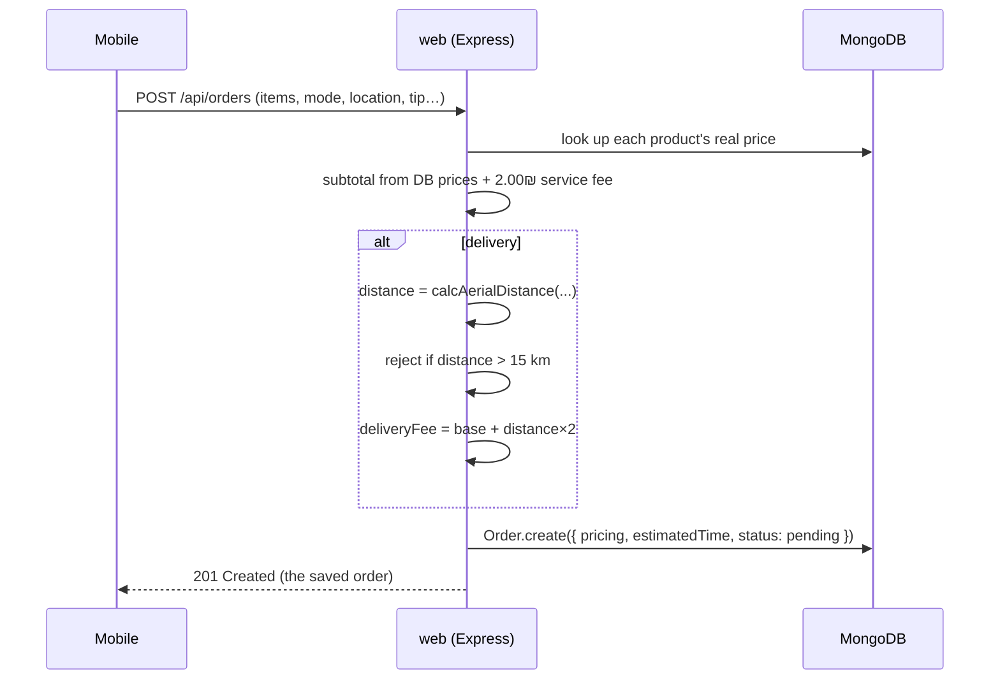

# 💳 Checkout & Placing an Order (Mobile)

Turn a cart into a real order — with delivery/pickup, scheduling, tipping, and a server-verified price.

**At a glance:** for **logged-in customers** · route `mobile/src/app/orders/checkout.tsx` · reached from a [cart](10-Cart.md).

## Place-order flow

The client shows a live price, but the **server recomputes everything** and has the final say — prices, delivery fee, distance limit, and estimated time can't be spoofed from the client.

## Delivery vs. pickup

A pill toggle switches **Delivery** / **Pickup**; pricing and estimated time recompute for the mode.

### 15 km delivery limit

Delivery is allowed only within **15 km** (aerial distance restaurant ↔ user), enforced twice:

- **Client** — before checkout, `mobile/src/app/orders/cart.tsx` computes the distance and, if it's over 15 km, offers "Proceed to Pickup"; checkout then opens with delivery disabled (grayed).
- **Server** — `POST /api/orders` recomputes and rejects a too-far delivery with `400` and the actual distance. See [Backend](13-Backend-Users-Orders.md).

## Order options

- **Cutlery** — quantity stepper (free), saved on the order.
- **Leave at my door** — an on-screen delivery preference on the checkout screen. *(UI preference; not stored on the order record.)*
- **Notes** — free-text note for the restaurant/courier, saved on the order.
- **Timing** — "Now" (dynamic estimate) or "Schedule for Later" (a modal of generated slots; base 15 min pickup / 45 min delivery, 30-min steps).
- **Tip** (delivery only) — quick amounts `[0, 5, 10, 15]` + custom input.
- **Payment** — Credit Card / Apple Pay / Cash (mock selection), saved on the order.

## Pricing breakdown

Shown live and recomputed authoritatively on the server:

| Line | How it's computed |
| --- | --- |
| Subtotal | Σ (product price × quantity), from DB prices |
| Service fee | flat **2.00 ₪** |
| Delivery fee | `restaurant.deliveryFee + (distanceKm × 2)` for delivery; `0` for pickup |
| Tip | selected tip (delivery) |
| **Total** | subtotal + service fee + delivery fee + tip |

Estimated time: delivery = `deliveryTime + items×2 + round(distanceKm×3)` min; pickup = `15 + items×2` min.

## Walkthrough

1. From a cart, open checkout. Toggle Delivery/Pickup and confirm the fee and estimate change.
2. Set a delivery address > 15 km away and confirm delivery is blocked with a "Pickup only" offer.
3. Adjust cutlery, add a note, pick a tip and a payment method.
4. Choose "Schedule for Later" and confirm the time-slot modal appears.
5. Place the order and confirm it appears in [Order History](12-Order-History-and-Reorder.md) as "Pending".

## Media

> 🎥 **Capture — `flow-order.mp4`** ([guide V5](00-Media-Capture-Guide.md#-videos-headline-flows))
> **Record:** browse a restaurant → add items → cart → checkout (delivery) → place order → see it in history → reorder. ~45s. (Spans this page and [Order History](12-Order-History-and-Reorder.md).)

> 📷 **Capture — `checkout-delivery.png`** ([guide K1](00-Media-Capture-Guide.md#-cart--checkout--orders)) · phone · light
> **Show:** checkout in delivery mode with the full pricing breakdown.

> 📷 **Capture — `checkout-pickup-alert.png`** ([guide K2](00-Media-Capture-Guide.md#-cart--checkout--orders)) · phone · light
> **Show:** the "too far → Pickup only" alert (address > 15 km).

> 📷 **Capture — `checkout-tip-pay.png`** ([guide K3](00-Media-Capture-Guide.md#-cart--checkout--orders)) · phone · light
> **Show:** the tip selector + payment method options.

> 📷 **Capture — `checkout-schedule.png`** ([guide K4](00-Media-Capture-Guide.md#-cart--checkout--orders)) · phone · light
> **Show:** the schedule-for-later time-slot modal.

The web app's end-to-end cart→checkout→order flow is also recorded — see **"▶ Happy flow"** in the main [README's demo videos](../README.md#-demo-videos).

---

↩ [Wiki index](README.md) · Next: [Order History & Reordering](12-Order-History-and-Reorder.md)
