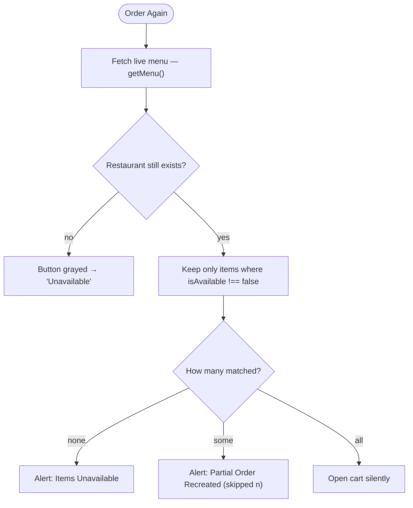

# 📦 Order History & Reordering (Mobile)

Past orders with live status, full receipts, and a reorder that checks the menu is still valid.

**At a glance:** for **logged-in customers** · route `mobile/src/app/orders/order-history.tsx` · data from `getUserOrders()` → `GET /api/orders`.

## Order list & statuses

Each order is a card with a **status badge** (icon + color):

| Status | Meaning |
| --- | --- |
| 🟠 Pending | placed, awaiting the restaurant |
| 🔵 Accepted | restaurant accepted it |
| 🟣 Preparing | being prepared |
| 🟦 On the way | out for delivery |
| 🟢 Delivered | completed |
| 🔴 Cancelled | cancelled |

These map to the `status` enum on the `Order` model (see [Backend](13-Backend-Users-Orders.md)).

## Detail modal

"Details" opens a bottom-sheet with the full itemized receipt (each item's quantity, name, price), the pricing breakdown (subtotal, service fee, delivery fee, tip, total), and any notes.

## Smart "Order Again"

Reorder re-validates against the restaurant's **live** menu instead of blindly recreating the old cart:

## Deleted-restaurant handling

Orders survive their restaurant being deleted by an admin, without crashing:

- A local metadata cache in `AsyncStorage` (`@restaurant_meta_cache`) keeps each restaurant's last-known details; when a live fetch fails, the card falls back to the cached info and a storefront placeholder icon.
- For a removed restaurant, the "Order Again" button is disabled and grayed, showing **"Unavailable"**.

Images render both base64 (`data:…`) and `http` URLs, with themed placeholders when missing.

## Walkthrough

1. Place an order ([Checkout](11-Checkout.md)) and confirm it appears here as "Pending".
2. Open "Details" and confirm the itemized receipt + totals match your order.
3. "Order Again" on an order whose items all still exist — confirm the cart is recreated and opens.
4. As an admin, mark one of that restaurant's dishes unavailable (or delete it), then "Order Again" and confirm the skipped-items alert.
5. Delete the whole restaurant as its owner, return here, and confirm the order still renders and "Order Again" is grayed to "Unavailable" (no crash).

## Media

> 📷 **Capture — `orders-history.png`** ([guide R1](00-Media-Capture-Guide.md#-cart--checkout--orders)) · phone · light
> **Show:** the order-history list with several status badges.

> 📷 **Capture — `orders-detail.png`** ([guide R2](00-Media-Capture-Guide.md#-cart--checkout--orders)) · phone · light
> **Show:** the order detail modal with the itemized receipt.

> 📷 **Capture — `orders-partial.png`** ([guide R3](00-Media-Capture-Guide.md#-cart--checkout--orders)) · phone · light
> **Show:** the "Partial Order Recreated" alert after a reorder.

> 📷 **Capture — `orders-unavailable.png`** ([guide R4](00-Media-Capture-Guide.md#-cart--checkout--orders)) · phone · light
> **Show:** an order whose restaurant was deleted, with the grayed "Unavailable" reorder button.

---

↩ [Wiki index](README.md) · Next: [Backend: Users & Orders](13-Backend-Users-Orders.md)
