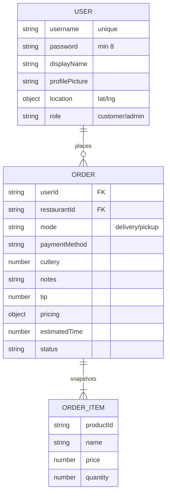

# 🗄️ Backend: Users & Orders

How accounts and orders are stored and served. Persistence is on MongoDB via Mongoose; auth is stateless JWT (no token collection needed). Counterpart to [Backend: Restaurants & Products](08-Backend-Restaurants-Products.md), which holds the full [data model](08-Backend-Restaurants-Products.md#data-model).

## Data model (this slice)



## Mongoose schemas

**`src/models/User.js`**

| Field | Type | Notes |
| --- | --- | --- |
| `username` | String | required, **unique**, trimmed |
| `password` | String | required, min length 8 (hashed, not plaintext) |
| `displayName` | String | required |
| `profilePicture` | String | required — URL or base64 data URI |
| `location.lat` / `location.lng` | Number | both required |
| `role` | String | enum `customer` \| `admin`, default `customer` |

**`src/models/Order.js`**

| Field | Type | Notes |
| --- | --- | --- |
| `userId` | String | required |
| `restaurantId` | String | required |
| `items[]` | subdoc | `{ productId, name, quantity (≥1), price }` — a snapshot taken at order time |
| `mode` | String | enum `delivery` \| `pickup`, required |
| `paymentMethod` | String | required |
| `cutlery` | Number | default `0` |
| `notes` | String | default `''` |
| `location.lat` / `location.lng` | Number | delivery destination (null for pickup) |
| `tip` | Number | default `0` |
| `pricing` | subdoc | `{ subtotal, serviceFee, deliveryFee, finalTip, total }` — all required |
| `estimatedTime` | Number | required, minutes |
| `status` | String | enum below, default `pending` |

Order status enum: `pending` · `accepted` · `preparing` · `on_the_way` · `delivered` · `cancelled` (rendered as badges in [Order History](12-Order-History-and-Reorder.md#order-list--statuses)).

## REST routes

**`src/routes/users.routes.js`**

| Method | Path | Auth | Notes |
| --- | --- | --- | --- |
| POST | `/api/users` | — | register |
| GET | `/api/users/:id` | — | fetch a user |
| PATCH | `/api/users/:id` | auth | update profile |
| DELETE | `/api/users/:id` | auth | delete (ownership-checked) |

**`src/routes/tokens.routes.js`**

| Method | Path | Auth | Notes |
| --- | --- | --- | --- |
| POST | `/api/tokens` | — | login → `{ token, user }` |

**`src/routes/orders.routes.js`** (all require auth)

| Method | Path | Auth | Notes |
| --- | --- | --- | --- |
| POST | `/api/orders` | auth | place an order (server computes pricing/distance) |
| GET | `/api/orders` | auth | the caller's orders |
| GET | `/api/orders/:id` | auth | one order |
| PATCH | `/api/orders/:id` | auth | update an order |
| DELETE | `/api/orders/:id` | auth | delete an order |
| PATCH | `/api/orders/:id/status` | admin | update order status |
| GET | `/api/orders/restaurant/:restaurantId` | admin | all orders for a restaurant (owner view) |

## Server-authoritative order creation

`src/controllers/orders.controller.js` (`createOrder`) never trusts client-supplied prices — it recomputes from the database (see the [place-order sequence](11-Checkout.md#place-order-flow)):

- **Subtotal** from each product's DB `price` × quantity, after verifying every product exists and belongs to `restaurantId`.
- **Service fee**: flat `2.00 ₪`.
- **Delivery fee** (delivery): `restaurant.deliveryFee + distanceKm × 2`.
- **15 km limit**: `MAX_DELIVERY_RADIUS_KM = 15`; a farther delivery is rejected `400` with the actual distance.
- **Estimated time**: delivery `deliveryTime + items×2 + round(distanceKm×3)`; pickup `15 + items×2`.

Distance uses `calcAerialDistance` from `src/services/distance.js` — the same helper the restaurant radius filter uses ([Backend: Restaurants & Products](08-Backend-Restaurants-Products.md)).

## Try it

```bash
# login, then list orders (auth required)
TOKEN=$(curl -s -X POST http://localhost:3000/api/tokens \
  -H 'Content-Type: application/json' \
  -d '{"username":"<user>","password":"<pass>"}' | jq -r .token)

curl http://localhost:3000/api/orders -H "Authorization: Bearer $TOKEN" | jq 'length'
```

---

↩ [Wiki index](README.md) · Related: [Checkout](11-Checkout.md) · [Order History](12-Order-History-and-Reorder.md)
