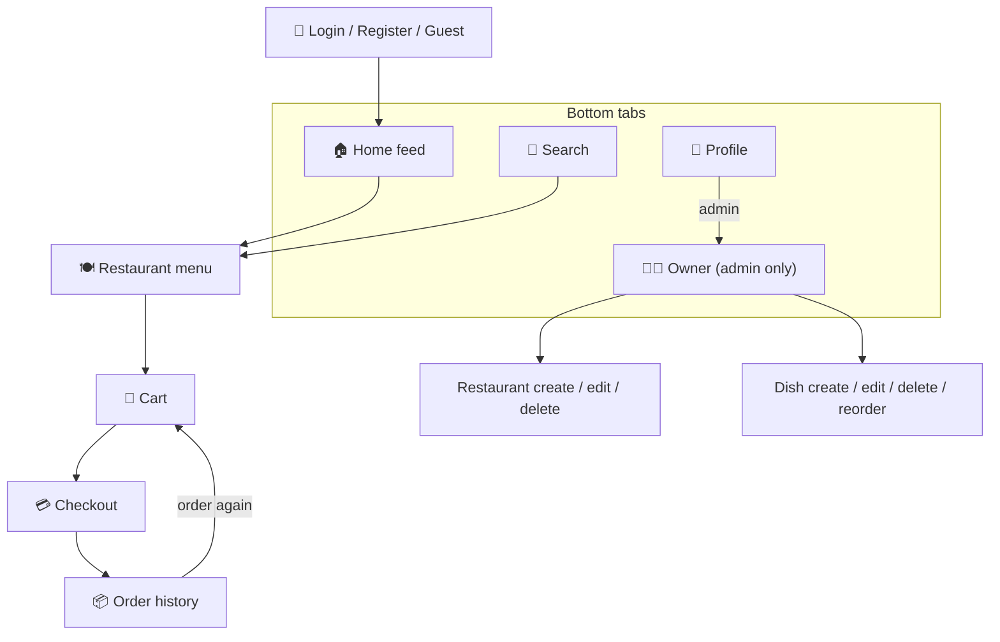

# 🍔 Wolt-Clone — Project Wiki

A guided tour of the whole system: a **React Native (Expo)** mobile app and a **React** web app, both talking to one **Node/Express + MongoDB** backend that bridges to a **C++ recommendation** server — all started with a single `docker compose up`.

> [!TIP]
> **Start here:** [Environment Setup](01-Environment-Setup.md) to get everything running, then follow the [Media Capture Guide](00-Media-Capture-Guide.md) if you're filling in screenshots.

## What this wiki walks you through

- **Getting the system running** — one command builds and starts every service; how to verify it and run the mobile app against it → [Environment Setup](01-Environment-Setup.md)
- **Getting into the app** — creating an account with validation, browsing as a guest, logging in and out → [Authentication & Profile](09-Auth-and-Profile.md)
- **Discovering & ordering food** — the home feed, search, a restaurant's menu, building a cart, and checking out → [Home](02-Home-and-Browsing.md) · [Search](03-Search.md) · [Menu](04-Restaurant-Menu.md) · [Cart](10-Cart.md) · [Checkout](11-Checkout.md)
- **Managing restaurants & menus** — the owner dashboard and full create/edit/delete for restaurants and dishes → [Owner Dashboard](05-Owner-Dashboard.md) · [Restaurant CRUD](06-Restaurant-CRUD.md) · [Dish CRUD](07-Dish-CRUD.md)
- **Tracking orders** — order history, receipts, and smart reordering → [Order History & Reordering](12-Order-History-and-Reorder.md)
- **How it's built** — the MongoDB data model and API behind both halves → [Backend: Restaurants & Products](08-Backend-Restaurants-Products.md) · [Backend: Users & Orders](13-Backend-Users-Orders.md)

## App at a glance

How the main screens connect:

## Pages

### Getting started
| # | Page | Covers |
| :---: | --- | --- |
| 00 | [Media Capture Guide](00-Media-Capture-Guide.md) | Master checklist of every screenshot & video to capture |
| 01 | [Environment Setup](01-Environment-Setup.md) | Bringing up the whole stack with `docker compose up --build`, verifying every service, running the mobile app against it |

### Restaurants & Menus
| # | Page | Covers |
| :---: | --- | --- |
| 02 | [Home & Browsing](02-Home-and-Browsing.md) | Mobile Home tab: categories, promoted carousel, all-restaurants feed, location |
| 03 | [Search](03-Search.md) | Mobile Search tab: All/Restaurants/Items results, sort, filters |
| 04 | [Restaurant Menu](04-Restaurant-Menu.md) | Mobile restaurant detail page: menu sections, item modal, in-page search |
| 05 | [Owner Dashboard](05-Owner-Dashboard.md) | Mobile Owner tab: role-gated restaurant management list |
| 06 | [Restaurant CRUD](06-Restaurant-CRUD.md) | Create / edit / delete a restaurant, on mobile and web |
| 07 | [Dish CRUD](07-Dish-CRUD.md) | Create / edit / delete / reorder menu items, on mobile and web |
| 08 | [Backend: Restaurants & Products](08-Backend-Restaurants-Products.md) | The MongoDB migration for this domain — schemas, routes, cascade delete, seed data |

### Users & Orders
| # | Page | Covers |
| :---: | --- | --- |
| 09 | [Authentication & Profile](09-Auth-and-Profile.md) | Register, login, guest mode, profile management, account deletion |
| 10 | [Cart](10-Cart.md) | Multi-restaurant carts, per-user isolation, guest → account migration |
| 11 | [Checkout](11-Checkout.md) | Delivery/pickup, 15 km limit, scheduling, tipping, payment, pricing breakdown |
| 12 | [Order History & Reordering](12-Order-History-and-Reorder.md) | Order tracking, detail modal, smart reorder, deleted-restaurant handling |
| 13 | [Backend: Users & Orders](13-Backend-Users-Orders.md) | The MongoDB migration for this domain — user/order schemas, routes, server-side order pricing |

## Media

Screenshots live under [`assets/mobile/`](assets/mobile/) (phone) and `assets/desktop/` (web/Docker); videos under `assets/video/` or embedded from the PR. Every spot that still needs a capture has a **capture block** on its page and a row in the [Media Capture Guide](00-Media-Capture-Guide.md).

## Related docs

- [README.md](../README.md) — top-level project README (features, architecture, full Docker quick start, web-app demo)
- [Ex3_README.md](../Ex3_README.md) — the Node/Express API server the apps talk to
